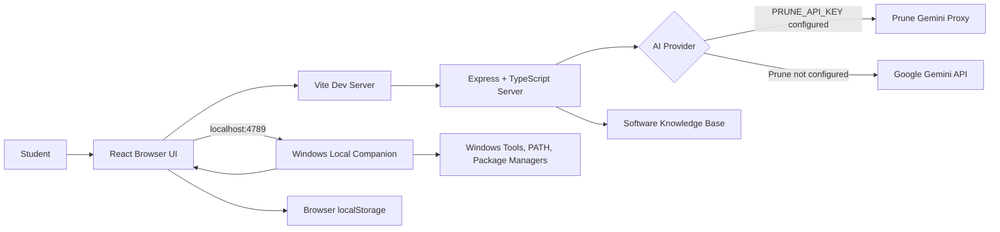
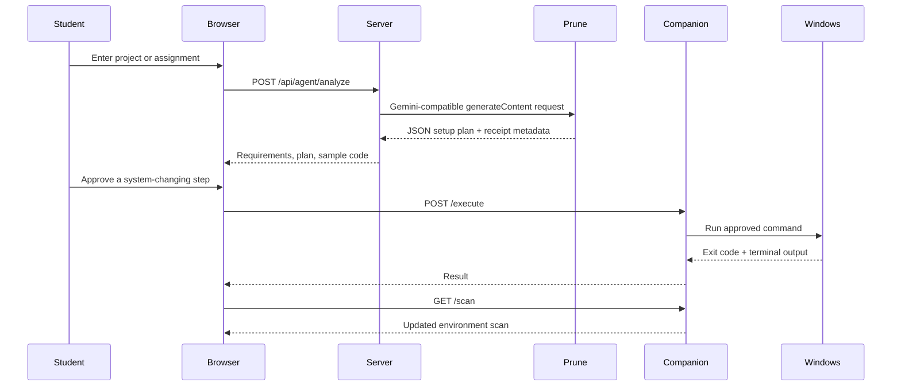

# DevSetup AI — Technical Architecture and User Guide

## 1. What is DevSetup AI?

DevSetup AI is a student-focused development-environment assistant. A user describes a project, assignment, programming language, database, or toolchain requirement. The application:

1. Identifies the software and versions required.
2. Compares requirements with the user's real Windows environment.
3. Creates an ordered setup plan.
4. Requests approval before system-changing commands run.
5. Executes approved commands through a local Windows companion.
6. Displays terminal output and verification status.
7. Generates sample programs and explains how to run them.
8. Diagnoses terminal and compiler errors.
9. Generates complete code solutions from a prompt or text assignment.
10. Provides a verified software knowledge base with official sources.

The application is designed so that the browser never directly receives API keys or executes operating-system commands.

---

## 2. High-Level Architecture



### Request flow



---

## 3. Technology Stack

### Frontend

- React 19
- TypeScript
- Vite
- Tailwind CSS
- `lucide-react` for icons
- Browser `localStorage` for active plans, step status, reports, projects, and terminal output

### Backend

- Node.js
- Express
- TypeScript executed with `tsx`
- `dotenv` for server-side environment variables
- `@google/genai` for direct Gemini fallback
- Native `fetch` for the Prune proxy

### AI providers

- Prune Gemini proxy (preferred when `PRUNE_API_KEY` exists)
- Google Gemini API fallback

### Local machine integration

- Generated PowerShell companion script
- `HttpListener` on `http://127.0.0.1:4789`
- Windows commands such as `winget`, `pip`, `npm`, `java`, `javac`, `gcc`, `g++`, `docker`, and `mysql`

---

## 4. Important Files

| File | Responsibility |
|---|---|
| `server.ts` | Express API, AI provider adapter, companion script, artifact routes |
| `src/App.tsx` | Main layout, navigation, global state |
| `src/components/SetupAgentView.tsx` | Setup analysis, approvals, execution, progress, camera/photo input |
| `src/components/MyEnvironmentView.tsx` | Installed software, removal actions, saved projects, reports |
| `src/components/TroubleshooterView.tsx` | Error diagnosis and approved fix execution |
| `src/components/CodeGeneratorView.tsx` | Code and assignment solution generation |
| `src/components/CatalogView.tsx` | Verified Software Knowledge Base |
| `src/components/CompanionView.tsx` | Download/start local companion and load scans |
| `src/types/devsetup.ts` | Shared frontend TypeScript types |
| `src/data/knowledgeBase.ts` | Curated software catalog |
| `vite.config.ts` | Vite, React, Tailwind, and development server configuration |
| `.env.example` | Safe configuration template |
| `.env` | Local secrets; never commit or share this file |
| `package.json` | Scripts and dependencies |

---

## 5. Application Navigation

### Setup Agent

Use this when preparing a project or assignment environment.

Inputs:

- Natural-language project request
- Assignment text
- `.txt` or `.md` upload
- Camera/photo input
- Optional real local environment scan

Outputs:

- Required software
- Installed/missing status
- Ordered setup steps
- Approval requirements
- Verification commands
- Sample test program
- Run instructions
- Expected output

Software removal intentionally does **not** appear here. Removal belongs in **My Environment**.

### My Environment

Shows:

- Operating system
- Architecture
- Installed tools
- Missing tools
- Versions and executable paths
- VS Code extension count
- Saved projects
- Previous setup reports

Installed tools have a **Remove** action. Removal requires confirmation, executes through the local companion, and rescans the computer afterward.

Shared dependencies are preserved when removing them could break another application.

### Troubleshooter

Paste:

- Terminal output
- Compiler errors
- IDE errors
- Optional context about what was being attempted

The result includes:

- Classification
- Severity
- Plain-English cause
- Recommended fix
- Proposed commands
- Verification command
- Prevention tip

Commands can be copied or run through the local companion after confirmation.

### Software Knowledge Base

This is the curated registry used by the Setup Agent. Each entry can contain:

- Software name
- Category
- Recommended version
- Official website
- Installation command
- Verification command
- Notes
- Windows package-manager identifier

### Local Companion

The companion is responsible for operations that a browser cannot safely perform:

- Scanning installed tools
- Reading PATH entries
- Reading selected environment variables
- Listing VS Code extensions
- Running approved commands
- Returning terminal output

### Code Generator

Use this for:

- “Generate binary search in C++”
- “Solve this Python assignment”
- “Explain this Java program”
- “Create a runnable React example”

It returns:

- Complete code
- Explanation
- Step-by-step walkthrough
- Filename
- Run command
- Expected output

---

## 6. Backend API Reference

### `POST /api/agent/analyze`

Creates a setup plan.

Example request:

```json
{
  "prompt": "I need C++ and VS Code for a data structures assignment",
  "assignmentText": "Optional assignment text",
  "assignmentImage": "Optional data URL image",
  "localScan": "Optional LocalEnvironmentScan object"
}
```

Returns:

- `projectTitle`
- `summary`
- `requirements`
- `setupPlan`
- `sampleProject`
- `nextSteps`

### `POST /api/agent/code`

Generates code or solves an assignment.

```json
{
  "request": "binary search",
  "language": "C++",
  "assignmentText": "Optional assignment text"
}
```

### `POST /api/agent/troubleshoot`

Analyzes an error.

```json
{
  "errorOutput": "g++ is not recognized...",
  "context": "Compiling a C++ file in VS Code",
  "localScan": "Optional scan"
}
```

### `GET /api/knowledge-base`

Returns the server knowledge base.

### `GET /api/health`

Returns service status and the active AI provider:

```json
{
  "ok": true,
  "service": "devsetup-ai",
  "aiProvider": "prune"
}
```

### `GET /api/usage`

Returns in-process Prune usage counters:

- Provider
- Request count
- Cache-hit count
- Last Prune metadata receipt

Counters reset when the server restarts. Long-term billing and usage remain in the Prune dashboard.

### `GET /api/companion/script`

Downloads the Windows companion PowerShell script.

### `POST /api/companion/sync-scan`

Stores a scan received from the browser-side companion flow.

### `GET /api/companion/sync-scan`

Returns the latest server-side synchronized scan.

---

## 7. AI Provider Configuration

### Prune mode

When `PRUNE_API_KEY` is configured, all AI calls use the Prune Gemini proxy:

```env
PRUNE_API_KEY="your_prune_key"
PRUNE_GEMINI_URL="https://api.withprune.com/v1/proxy/gemini/generateContent"
PRUNE_MODEL="gemini-3.5-flash-lite"
```

The provider key belongs in Prune's vault, not in this project.

The server sends:

- `X-Prune-Key`
- `X-Prune-Feature-Id: devsetup-ai`
- Gemini model name
- Chat-style messages
- JSON response guidance

Prune receipts are captured in memory for `/api/usage`.

### Gemini fallback mode

If Prune is not configured, the server can use:

```env
GEMINI_API_KEY="your_gemini_key"
```

### Security rules

- Never put either API key in React source code.
- Never prefix browser-exposed variables with `VITE_`.
- Never commit `.env`.
- Rotate keys that have been pasted into public chats, screenshots, commits, or issue reports.
- Keep provider keys in Prune's vault when using Prune.

---

## 8. Running the Project

### Install dependencies

```powershell
cd "C:\Users\Orla Ravi Threni\Downloads\Devsetup-AI-main (2)\Devsetup-AI-main"
npm install --legacy-peer-deps
```

The legacy peer flag is currently needed because the project's Vite and esbuild version ranges have a peer-dependency mismatch.

### Configure environment

```powershell
Copy-Item .env.example .env
```

Edit `.env` and add either Prune or Gemini configuration.

### Start development server

```powershell
npm run dev
```

Open:

```text
http://127.0.0.1:3000/
```

### Type-check

```powershell
npm run lint
```

### Production build

```powershell
npm run build
```

### Start compiled/static server

```powershell
npm start
```

---

## 9. Local Companion Flow

1. Open **Local Companion**.
2. Download `devsetup-companion.ps1`.
3. In Windows PowerShell 5.1, change to the download folder and run:

```powershell
cd "$HOME\Downloads"
$script = Get-ChildItem ".\devsetup-companion*.ps1" |
  Sort-Object LastWriteTime -Descending |
  Select-Object -First 1
powershell.exe -ExecutionPolicy Bypass -File $script.FullName
```

If PowerShell says the file does not exist, replace `$HOME\Downloads` with the
folder that actually contains the downloaded script. The `-File` path is relative
to the current PowerShell folder.

4. Keep the companion terminal open.
5. Return to the website.
6. Click **Scan Local Machine**.
7. Approve setup or removal commands only when the command and impact are understood.

The companion listens only on:

```text
http://127.0.0.1:4789
```

The companion uses a positive executable allowlist and rejects shell control
characters. Commands outside the catalog-backed setup flow are not executed.

The safety guard is not a replacement for human review. Always inspect generated commands before approval.

---

## 10. State and Refresh Behavior

The browser stores these items in `localStorage`:

- `devsetup_local_scan`
- `devsetup_projects`
- `devsetup_reports`
- `devsetup_active_analysis`
- `devsetup_step_outputs`

This lets the current setup plan survive a browser refresh.

The current implementation stores state per browser profile. It is not a multi-user database. A different browser or cleared browser storage will not see the same local progress.

After a companion command succeeds:

1. The step is marked complete.
2. Terminal output is displayed.
3. The companion is queried again.
4. Installed software status is refreshed.

---

## 11. Software Removal Design

Removal is intentionally located in **My Environment**, because the user must remove an actually installed tool rather than remove a planned requirement.

The flow is:

```text
Installed tool
  -> User clicks Remove
  -> Confirmation dialog
  -> Official winget uninstall command
  -> Local Companion executes command
  -> Terminal output displayed
  -> Local scan refreshed
```

The package manager owns the exact installation files. Shared libraries and dependencies are not blindly deleted because they may be required by another program.

For a future production version, dependency cleanup should be backed by:

- A package-manager dependency graph
- An installation manifest created during setup
- Per-project virtual environments
- A dry-run preview
- A rollback or restore point

---

## 12. Performance and Cost Optimization

The current application improves latency and cost by:

- Using a lightweight model.
- Limiting output token counts.
- Sending a compact knowledge-base summary.
- Using Prune when configured.
- Capturing Prune cache and receipt metadata.
- Avoiding duplicate browser calls while a request is loading.

Additional production improvements:

1. Add request cancellation with `AbortController`.
2. Add server-side response caching for identical setup requests.
3. Use a persistent usage database instead of in-memory counters.
4. Add per-user and per-project budgets.
5. Add request IDs and structured logs.
6. Queue long-running installation jobs.
7. Stream progress events with Server-Sent Events or WebSockets.

---

## 13. Common Questions and Answers

### Does the browser receive the API key?

No. AI requests are made by `server.ts`. Keys are read from `.env` on the server.

### Why does setup analysis need the Local Companion?

Without it, the AI cannot truthfully know which software is installed. It will mark the environment as not scanned instead of inventing installed tools.

### Why does an installation not immediately appear as installed?

The companion must rescan the computer. The current flow rescans after companion execution. For a manually downloaded installer, run or refresh the companion scan after the installer finishes.

### Can the app uninstall all dependencies?

It removes the selected package through the official package manager. Shared dependencies are intentionally preserved because deleting them could break other software.

### Can I run commands directly from the browser?

Only through the local companion, and only after the user approves the action where required.

### Where do generated sample programs run?

The setup result provides the filename, editor/terminal location, run steps, command, and expected output.

### Can I upload an assignment?

Yes. The Setup Agent accepts text files and camera/photo input. Code Generator accepts pasted text or `.txt`/`.md` uploads.

### Why might AI output need JSON repair?

Some providers may return introductory text or Markdown fences despite JSON instructions. The server extracts and parses the JSON object before returning the result.

### What happens if Prune is unavailable?

The request returns a clear API error. The application does not silently pretend that the request succeeded. Remove `PRUNE_API_KEY` to use the configured Gemini fallback.

### Is this ready for multiple users?

It is currently a local development application. Production multi-user support would require authentication, a database, per-user authorization, job isolation, audit logs, rate limits, and a hardened companion protocol.

### Is the local companion safe for production?

It is a local development helper with allow/block behavior and explicit approvals. It should not be exposed publicly without authentication, signed commands, origin checks, command allowlists, and a stronger sandbox.

---

## 14. Production Readiness Checklist

- [ ] Rotate any keys exposed during development.
- [ ] Add authentication and authorization.
- [ ] Replace localStorage project state with a database.
- [ ] Add structured request and command audit logs.
- [ ] Add rate limits and per-user budgets.
- [ ] Add CSRF/origin protection for companion communication.
- [ ] Replace broad command execution with an allowlist.
- [ ] Add signed, expiring command approvals.
- [ ] Add automated tests for API routes and safety guards.
- [ ] Add dependency lockfile and reproducible deployment.
- [ ] Add monitoring for latency, failures, Prune receipts, and cache hits.
- [ ] Review all generated uninstall commands before production use.

---

## 15. Useful Commands

```powershell
# Start the app
npm run dev

# Type-check
npm run lint

# Build
npm run build

# Check server health
Invoke-WebRequest http://127.0.0.1:3000/api/health

# Check Prune usage counters
Invoke-WebRequest http://127.0.0.1:3000/api/usage
```

---

## 16. Summary

DevSetup AI combines:

- A React student-friendly interface.
- An Express server-side AI gateway.
- Prune cost/security controls.
- Gemini fallback support.
- A curated software knowledge base.
- A local Windows environment scanner.
- Explicit approval before system changes.
- Persistent setup progress.
- Troubleshooting and terminal output.
- Assignment-aware code generation.

The most important operating principle is: **the AI recommends, the student approves, and the local companion executes while the application records the result.**

## 17. Secure Local Companion

The downloaded PowerShell companion creates a random session token at startup and prints it only in the local console. Paste that token into the Companion screen; browser requests then send it in `X-Companion-Token`. The companion accepts only the app's localhost origins, prompts for approval in the laptop console, rejects shell control characters, and runs only allowlisted developer executables without dynamic shell evaluation.

Every approval, command, and result is appended to the local `devsetup-activity.log` file. The file is intentionally ignored by Git because it can contain local paths and commands. Failed setup commands can be sent to the troubleshooting API for up to three approved fix attempts.

Generated setup scripts never trust AI-provided install commands. The server replaces them with commands from `src/data/knowledgeBase.ts`; unknown software is reported for manual installation instead of being executed automatically.
